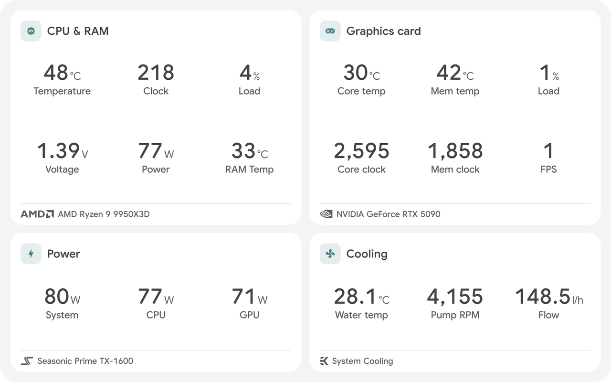
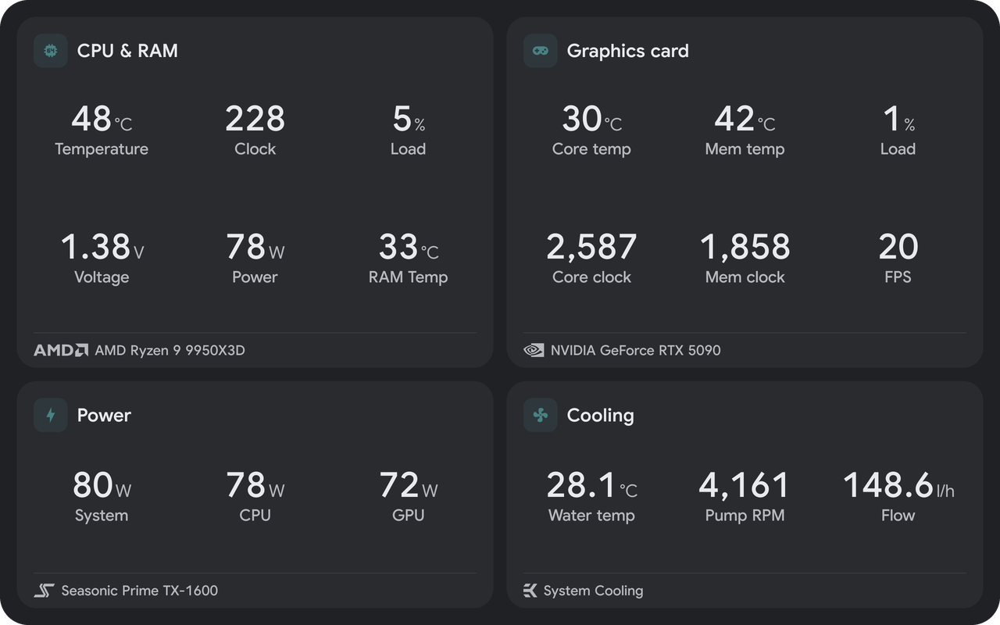

# HWiNFO Monitor for Kiosk Satellite

A [Kiosk Satellite](https://github.com/jxlarrea/kiosk-satellite) plugin that reads the sensors of your PCs through HWiNFO's Remote Sensor Monitoring. Pick the sensors Home Assistant should get, lay them out in a native **PC sensors** screensaver and let the plugin switch to it on its own when your PC runs hot.

| Light theme | Dark theme |
| --- | --- |
|  |  |

- **Several PCs at once.** Add every PC that runs HWiNFO. Sensors from all of them show in one searchable picker, grouped by computer and device, with their current values.
- **Home Assistant sensors.** Each sensor you pick shows up on the kiosk's ESPHome device, with the right unit and device class. Yes or no sensors become binary sensors. Every PC also gets an online sensor.
- **PC sensors screensaver.** Panels with a title, an icon, a grid of large values and an optional footer with a logo, drawn natively by the kiosk in its own look, light or dark with the Kiosk Satellite theme. Panels can share a column. Tiles can show the current, minimum, maximum or average value and turn red past a limit. **Build** makes a starter layout from your own sensors.
- **Automatic switching.** Show PC sensors while a sensor stays past a limit, for example while the CPU temperature stays above 80°C for 30 seconds. Your own screensaver setting returns once it cools down again.

This plugin is not affiliated with or endorsed by REALiX or HWiNFO. Its icon is the official HWiNFO logo, used only to show the service it connects to.

## Requirements

- Kiosk Satellite 2026.10.35 or newer. Older versions refuse to install the plugin.
- [HWiNFO](https://www.hwinfo.com/) on each PC, running in sensors mode with **Remote Sensor Monitoring** on. Open HWiNFO's sensor window, choose **Settings**, then **Remote Monitoring**, turn on **Enable Remote Sensor Monitoring** and keep port **27007**. HWiNFO's free version stops sharing sensors after 12 hours, so restart it or use HWiNFO Pro.
- The PC's firewall must let the kiosk reach TCP port 27007.
- Frame rates need HWiNFO's **PresentMon** sensor or RivaTuner Statistics Server. Their framerate sensors then show up like any other sensor.

## Installation

### Community Plugins (Recommended)

HWiNFO Monitor is listed in [Community Plugins](https://kiosksatellite.com/plugins/). Use the button below to open it in your Kiosk Satellite and install it.

[](https://kiosksatellite.com/redirect/plugin/?repository=jxlarrea/hwinfo64-kiosk-satellite-plugin)

Or search for `HWiNFO Monitor` in **Settings > Plugin Manager > Browse plugins** in Kiosk Satellite.

### Manual

1. Open **Settings > Plugin Manager** in Kiosk Satellite and turn on **Enable Plugins**.
2. Choose **Add plugin**, paste `https://github.com/jxlarrea/hwinfo64-kiosk-satellite-plugin` and choose **Preview**.
3. Review the plugin and choose **Trust and install**.

## Setup

1. Open **Plugin Manager > HWiNFO Monitor** and enable it.
2. Under **Computers**, add each PC with a name and its IP address. Press **Test** to check that they answer.
3. Under **Home Assistant**, add the sensors Home Assistant should get. The picker lists every sensor of every PC that answered. Press its refresh button to read them again.
4. Under **Screensaver**, press **Build** for a starter layout or add panels yourself. Then choose **PC sensors (HWiNFO Monitor)** under **Screensaver > Screensaver mode**, or let the automatic switch below pick it.
5. Under **Automatic screensaver**, turn on **Switch screensaver automatically**, pick a sensor such as **CPU (Tctl/Tdie)** on AMD or **CPU Package** on Intel and set the limit and times.

## Settings

| Group | Setting | What it does |
| --- | --- | --- |
| Computers | Computers | Name and address of each PC. Add `:port` to the address if HWiNFO doesn't use 27007. Up to 8 |
| Computers | Update every | Seconds between updates, 1 to 30 |
| Home Assistant | Sensors | Sensors sent to Home Assistant, with an optional name. Up to 22 |
| Screensaver | Panels | Title, icon, columns, stacking, sensors, header sensor, footer text and logo of each panel |
| Screensaver | Theme, Custom colors, Accent color, Panel color, Background, Text color, Text size, Value size, Label size | How the screensaver looks. Theme picks light or dark, or Auto to follow the Kiosk Satellite theme. Custom colors replaces the theme with your own colors |
| Automatic screensaver | Switch screensaver automatically | Turns the rule on |
| Automatic screensaver | Sensor, When it is, Limit | The condition, such as a CPU temperature above 80 |
| Automatic screensaver | For at least, Switch back after | Seconds the condition must hold before switching and before switching back |
| Automatic screensaver | Start the screensaver right away | Starts it as soon as the rule switches instead of after the usual idle time |

The **Show PC sensors** action starts the PC sensors screensaver right away until it is dismissed. Assign it to a gesture, the kiosk drawer or a Home Assistant button from the plugin page.

Sensors are saved by the PC's own name and HWiNFO's sensor IDs, so they survive a new IP address and HWiNFO restarts.

## Home Assistant

With ESPHome and native entities on in Kiosk Satellite, the kiosk's device gets:

- One Home Assistant sensor for each sensor you add under **Home Assistant**, named after the PC and the HWiNFO sensor unless you give it a name.
- **PC name online**, a connectivity binary sensor for each PC.
- **Sensor screensaver active**, a binary sensor that is on while the automatic rule shows PC sensors.

Exclude any of them in the kiosk's ESPHome entity picker.

## Data and privacy

The plugin connects only to the addresses you add, on your own network, using HWiNFO's remote monitoring protocol on TCP port 27007. It sends nothing anywhere else. Values reach Home Assistant only through the kiosk's own ESPHome connection and only for the sensors you pick.

## Build

Install Python 3, JDK 17 or newer and an Android SDK with build-tools. Then run:

```sh
python3 tools/test.py
python3 tools/build.py
```

Install the ZIP from `dist/` through **Plugin Manager > Developer Tools > Install from ZIP**. Releases are built by GitHub Actions from a published release tag.

## License

[Apache-2.0](LICENSE). The screensaver uses brand logos from [Simple Icons](https://simpleicons.org/) under CC0, Seasonic's mark from its [brand assets](https://www.seasonic.com/brand-assets) and EK's mark traced from its public domain logo. See [NOTICE](NOTICE). Brand names and logos belong to their owners.
